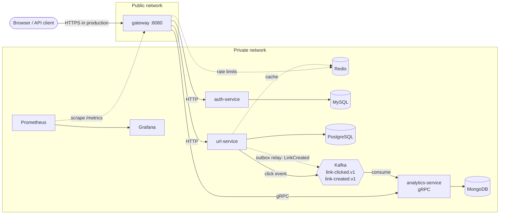

# ClickTrail

**A production-style URL shortener with click analytics, built as five Go microservices.**
Short links in, click statistics out. It is a portfolio project designed to show Go microservices end to end:
REST and gRPC APIs, JWT security with roles, four kinds of data stores, event-driven messaging with Kafka,
containers, CI/CD, AWS deployment and monitoring.

> **Repository status.** This repository (the platform: deployment, infrastructure, observability and documentation) is public.
> The four service repositories are **currently private** while I tidy them up, so their links would show "404" to visitors.
> Their design, behaviour and results are documented here, and `clicktrail-proto` (the gRPC contract) is already public.
> I am happy to walk through the service code in an interview or share access on request.

---

## Tech stack

| Area | Technology |
|---|---|
| Language | **Go** (1.27), standard `net/http` plus **Gin**, `log/slog` structured logging |
| APIs | **REST** (JSON) for clients, **gRPC / Protocol Buffers** between services (contract managed with `buf`) |
| Security | **JWT** (HS256, 15 min), **RBAC** (`user` / `admin`), bcrypt password hashing, rate limiting, header stripping at the trust boundary |
| Data | **MySQL** (users), **PostgreSQL** (links), **MongoDB** (click events), **Redis** (cache and rate-limit counters); **GORM** and SQL migrations (`golang-migrate`) |
| Messaging | **Apache Kafka** (KRaft), at-least-once delivery with idempotent consumers |
| Resilience | Circuit breaker (`sony/gobreaker`), retries with jitter, timeouts, graceful shutdown, health and readiness probes |
| Containers | **Docker** (multi-stage, non-root, read-only filesystem), **Docker Compose** |
| Orchestration | **Kubernetes** manifests (Kustomize, validated with `kubeconform`; `kind` for local runs) |
| Cloud | **AWS**: EC2, Systems Manager (SSM), Secrets Manager, S3, IAM with GitHub OIDC, Elastic IP |
| CI/CD | **GitHub Actions**: lint, tests, vulnerability scan, secret scan, image build, release by tag, manual deploy with no stored credentials |
| Observability | **Prometheus** and **Grafana** (15-panel dashboard), request IDs across services |
| Quality | `golangci-lint`, `govulncheck`, `gitleaks`, `shellcheck`, `actionlint`, `buf breaking`, Dependabot |

---

## What it does

1. A user registers and logs in and receives a short-lived token.
2. The user creates a short link for a long URL.
3. Anyone opens the short link and is redirected (HTTP 302).
4. The owner sees how many times the link was clicked. Other users cannot see it.
5. An admin sees platform-wide totals. A normal user gets `403 Forbidden`.
6. An operator watches health, latency and message lag on a Grafana dashboard.

## Architecture



Only the **gateway** is reachable from the internet. Every service owns its own database and never reads another service's data.

| Service | Responsibility | Stack |
|---|---|---|
| `clicktrail-gateway` | Single entry point: verifies the JWT, enforces roles, rate-limits, forwards requests, answers statistics queries | Go, Gin, reverse proxy, Redis, gRPC client |
| `clicktrail-auth-service` | Register, log in, issue tokens, create the first admin | Go, Gin, GORM, MySQL, bcrypt, JWT |
| `clicktrail-url-service` | Create and resolve short links, cache, publish events | Go, Gin, GORM, PostgreSQL, Redis, Kafka |
| `clicktrail-analytics-service` | Store clicks, keep a copy of link owners, serve counts | Go, Kafka consumer, MongoDB, gRPC server |
| `clicktrail-proto` | The gRPC contract (public repository) | Protocol Buffers, `buf` |
| `clicktrail-platform` | This repository | Compose, Kubernetes, Prometheus, Grafana, AWS scripts, docs |

## How it works

**Opening a short link** (`GET /r/aB3dE9x`)
1. The gateway applies the rate limit and forwards the request to the URL service.
2. The URL service looks in **Redis** first (cache-aside), then **PostgreSQL**, and answers `302`.
3. It publishes a `LinkClicked` event to **Kafka** asynchronously, so the visitor never waits for analytics.
4. The analytics service reads the event, stores it in MongoDB (the event ID is the document ID, so duplicates are ignored) and only then confirms it to Kafka.

**Creating a link and the transactional outbox**
1. The URL service saves the link **and** a `LinkCreated` row in an outbox table in **one database transaction**.
2. A background relay publishes the row to Kafka and marks it sent only after Kafka confirmed it. If Kafka is down, the row waits.
3. The analytics service stores `shortCode -> owner`. This copy lets it answer "how many clicks does *my* link have?" on its own.

This solves the **dual-write problem**: saving to a database and publishing to Kafka cannot share a transaction, so without an outbox a crash in between loses the event.
See [ADR 0007](docs/adr/0007-outbox-and-owner-read-model.md).

**Viewing statistics** (`GET /api/v1/links/{code}/stats`)
The gateway verifies the token and makes one gRPC call to the analytics service with the short code and the user ID from the token. Analytics checks the owner and returns the count.
Unknown links and other people's links both answer `404`, so short codes cannot be probed. Statistics keep working even when the URL service is down.

## Design patterns and engineering practices

| Pattern | Where |
|---|---|
| API gateway, database per service, polyrepo | whole system |
| Layered services (`handler` -> `service` -> `repository`) with interfaces at the boundaries | every service |
| Cache-aside | URL service with Redis |
| Event-driven messaging, at-least-once delivery, idempotent consumer | URL service -> Kafka -> analytics |
| Transactional outbox, read model | LinkCreated events |
| Circuit breaker, retry with jitter, fail-open rate limiter | gateway |
| Decorator (wrapping a client with resilience) | gateway |
| Graceful shutdown, health and readiness probes, config from environment | every service |
| Decision records (ADRs) | [docs/adr/](docs/adr/) |

## Reliability: what happens when something fails

| Failure | Behaviour |
|---|---|
| Redis down | Redirects still work (database); the rate limiter fails open |
| Kafka down | Redirects and link creation still work; new-link events wait in the outbox and are sent when Kafka returns; the analytics service keeps running and retries |
| A service down | After 5 failures in a row the gateway opens that service's circuit for 10 seconds and answers `503` with `Retry-After`; other routes keep working |
| URL service down | Statistics still work (analytics has its own copy of the owners) |
| A message arrives twice | Stored once |

These behaviours are covered by unit tests, and the circuit breaker and the outbox were also checked on the real server by stopping a service and Kafka on purpose.

## Delivery and operations

- **Release:** a version tag in a service repository builds an immutable, versioned image in GitHub Container Registry.
- **Deploy:** a manual GitHub Actions workflow gets **short-lived AWS credentials through OIDC** (nothing stored in GitHub), uploads the stack files to S3 and tells the EC2 instance to deploy through **AWS Systems Manager**. There is **no SSH and no key** in the pipeline.
- **Secrets:** kept in **AWS Secrets Manager**, read by the instance role at deploy time, validated and written to an owner-only file. Never in git.
- **Smoke test:** [`scripts/smoke-test.sh`](scripts/smoke-test.sh) runs the user stories and the security rules against the running stack (27 checks on the server, 36 from the internet, including proof that internal ports are closed).
- **Monitoring:** Prometheus scrapes every service; the Grafana dashboard shows service health, request rates, latency, errors, cache hit ratio, Kafka lag, circuit-breaker state and the outbox backlog.

## Results

- A composite index `(owner_id, created_at DESC)` reduced a list query from **19.6 ms to 0.07 ms** (about 270 times) on 300,000 rows, measured with `EXPLAIN ANALYZE`.
- Circuit breaker verified by stopping a real service: calls were refused immediately with `503` and recovered by themselves.
- Transactional outbox verified by stopping Kafka: link creation still returned `201`, and the event arrived after Kafka was started again.

## Honest limitations

This is a demonstration, not a production system. There is a single instance of each data store, no TLS on the public port, and one environment.
The Kubernetes manifests are validated but have not been run on a cluster, and clicks use best-effort publishing.
The full list is in [docs/architecture.md](docs/architecture.md#known-limitations-honest-list).

## Start here

| I want to... | Read |
|---|---|
| understand what the product does | [docs/product-brief.md](docs/product-brief.md) |
| see how the pieces fit together | [docs/architecture.md](docs/architecture.md) |
| run it (Docker, Kubernetes, AWS) | [docs/runbook.md](docs/runbook.md) |
| set up the AWS deployment | [docs/aws-deploy-setup.md](docs/aws-deploy-setup.md) |
| understand why a decision was made | [docs/adr/](docs/adr/) |

## Quick start (needs Docker and access to the service images)

```bash
cd compose
cp .env.example .env      # fill in the secrets (letters and digits only)
docker compose up -d --wait
../scripts/smoke-test.sh http://localhost:8080 admin@example.com '<your ADMIN_PASSWORD>'
```

The service images are published as private packages for now, so running the stack needs access to them.
Then open Grafana at http://localhost:3000 and look at the **ClickTrail Overview** dashboard.

## Repositories

| Repository | Visibility |
|---|---|
| [`clicktrail-platform`](https://github.com/sunilvarmatongali/clicktrail-platform) (this repo) | public |
| [`clicktrail-proto`](https://github.com/sunilvarmatongali/clicktrail-proto) | public |
| `clicktrail-gateway`, `clicktrail-auth-service`, `clicktrail-url-service`, `clicktrail-analytics-service` | private for now |

## Repository layout

```
compose/            Docker Compose stack (all services, data stores, Prometheus, Grafana)
k8s/                Kubernetes manifests (Kustomize) and a kind cluster config
observability/      Prometheus config and the Grafana dashboard
scripts/            smoke-test.sh, aws/ (EC2 setup and deploy), k8s/ (kind deploy)
docs/               product brief, architecture, runbook, setup guide, decision records (ADRs)
.github/workflows/  ci.yml (validates everything), deploy.yml (manual deployment to AWS)
```

See [CONTRIBUTING.md](CONTRIBUTING.md) and [CHANGELOG.md](CHANGELOG.md).
