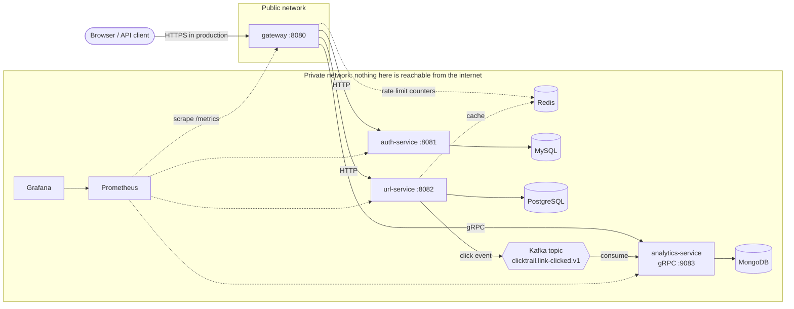

# Architecture

## The big picture

## Repositories

| Repository | Role |
|---|---|
| `clicktrail-proto` | gRPC contract between gateway and analytics |
| `clicktrail-gateway` | Public entry point: JWT check, RBAC, rate limits, forwarding, statistics |
| `clicktrail-auth-service` | Users, passwords, JWT issuing (MySQL) |
| `clicktrail-url-service` | Short links, redirects, cache, click events (PostgreSQL, Redis, Kafka) |
| `clicktrail-analytics-service` | Click storage and counts (Kafka, MongoDB, gRPC) |
| `clicktrail-platform` | This repository: Compose, Kubernetes, observability, AWS scripts, docs |

Each service has its own repository, tests, pipeline and version number, so a team could change and release it independently.

## Who owns which data

A service never reads another service's database. It asks the service over its API.

| Data | Owner | Store |
|---|---|---|
| Users and password hashes | auth-service | MySQL |
| Links | url-service | PostgreSQL (+ Redis cache) |
| Click events | analytics-service | MongoDB |
| Rate-limit counters | gateway | Redis |

## Ports

| Service | Port | Reachable from |
|---|---|---|
| gateway | 8080 (API) | **the internet** |
| gateway | 8090 (probes, metrics) | private network only |
| auth-service | 8081 | gateway, Prometheus |
| url-service | 8082 | gateway, Prometheus |
| analytics-service | 9083 (gRPC), 8083 (probes, metrics) | gateway / Prometheus |
| Prometheus, Grafana | 9090, 3000 | `localhost` of the VM only (use an SSH tunnel) |
| MySQL, PostgreSQL, MongoDB, Redis, Kafka | 3306, 5432, 27017, 6379, 9092 | private network only |

## What happens on a click

1. A visitor opens `/r/aB3dE9x`. The gateway applies the rate limit and forwards the request to url-service.
2. url-service looks in Redis, then PostgreSQL if needed, and answers `302`.
3. It also puts a `LinkClicked` event on Kafka (asynchronously, so the visitor does not wait).
4. analytics-service reads the event, stores it in MongoDB (duplicates are ignored) and only then confirms it to Kafka.
5. Later the owner asks the gateway for the statistics; the gateway verifies ownership with url-service and
   fetches the count from analytics-service over gRPC.

## Security design

- One public door: the gateway. Services trust the identity headers it sets, so it deletes client-sent ones first.
- Tokens: HS256 JWT, 15 minutes, issuer/expiry/role checked.
- Containers run as non-root with a read-only filesystem and no extra Linux capabilities.
- Secrets live in environment files and Kubernetes Secrets, never in git (a secret scanner runs in CI).
- On the VM only ports 22 (your address only) and 8080 are opened in the security group; the smoke test proves the others are closed.

## Reliability design

| Failure | Behaviour |
|---|---|
| Redis down | Redirects still work (database); rate limiter fails open |
| Kafka down | Redirects still work; click events are lost while it is down (best effort) |
| MongoDB down | Consumer retries with backoff; nothing is acknowledged until stored; lag grows and is visible |
| A service down | Gateway answers `502` with a trace ID; other routes keep working |
| A message is delivered twice | Stored once (event ID is the MongoDB `_id`) |

## Known limitations (honest list)

- **Single instance of every data store**, with temporary storage on Kubernetes. A production setup would use managed services
  (Amazon RDS, DocumentDB/Atlas, ElastiCache, MSK) with backups.
- **No TLS** between services and none on the public port in this version. Put a load balancer or reverse proxy with a certificate in front.
- **Shared-secret JWT (HS256)** and no refresh tokens or revocation; see the ADRs in the gateway and auth repos.
- **Click delivery from url-service to Kafka is best effort.** An outbox table would make it exact.
- **Counting scans documents** (indexed); pre-aggregated counters would be needed at large scale.
- **Duplicated small pieces of code** across services (middleware, config helpers). In a larger organisation they would live in a shared library.
- **NetworkPolicies** need a network plugin that enforces them; the default `kind` plugin does not.
